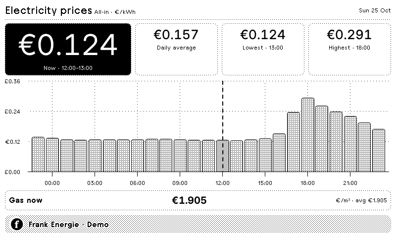

# Frank Energie

Today's electricity and gas prices on your TRMNL. See the current all-in rate, the day's average, low and high, and an hourly chart with the current period highlighted.

<a href="https://trmnl.com/recipes/245095"></a>

[Install on TRMNL](https://trmnl.com/recipes/245095)



Recorded demo prices, not current rates. [All layout previews](TRMNL#previews).

## Settings

- **Resource to Display:** Electricity or Gas (defaults to Electricity).
- No account or personal API key needed.

Full, half horizontal, half vertical and quadrant layouts support TRMNL OG, BWRY and TRMNL X, including portrait. Prices use €/kWh for electricity and €/m³ for gas. Data refreshes every 60 minutes.

## Develop locally

Install [trmnlp](https://github.com/usetrmnl/trmnlp), then run from the repository root:

```sh
cd TRMNL
trmnlp serve
```

Set `custom_fields.resource_type` in [TRMNL/.trmnlp.yml](TRMNL/.trmnlp.yml) to `Electricity` or `Gas`. Templates and settings live in [TRMNL/src/](TRMNL/src/); see the [plugin guide](TRMNL) for setup and layout details.

Data from [Frank Energie](https://www.frankenergie.nl/nl/dynamisch-energiecontract)'s public price feed.

[Questions or ideas?](https://github.com/taichikuji/trmnl-frank-energie-plugin/issues) · [License](LICENSE)
